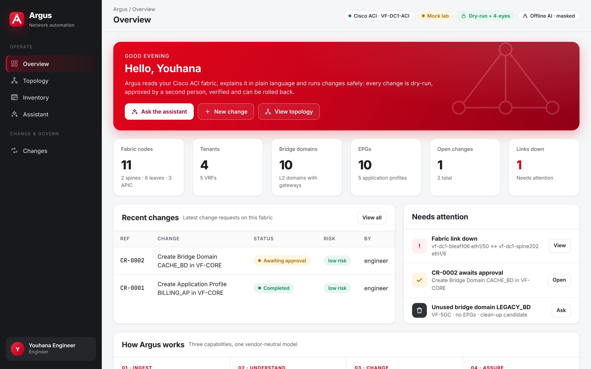
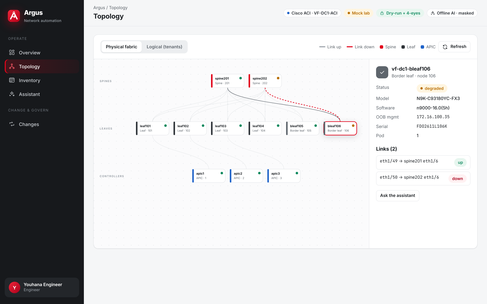
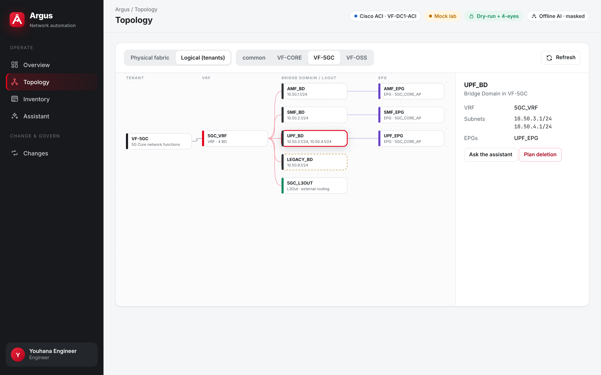
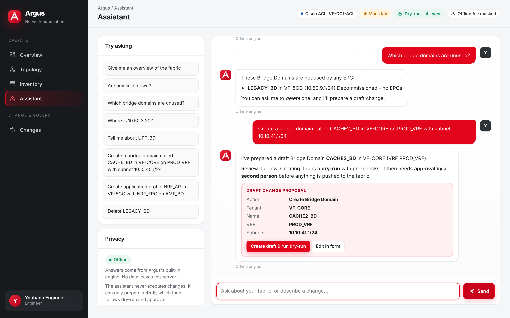
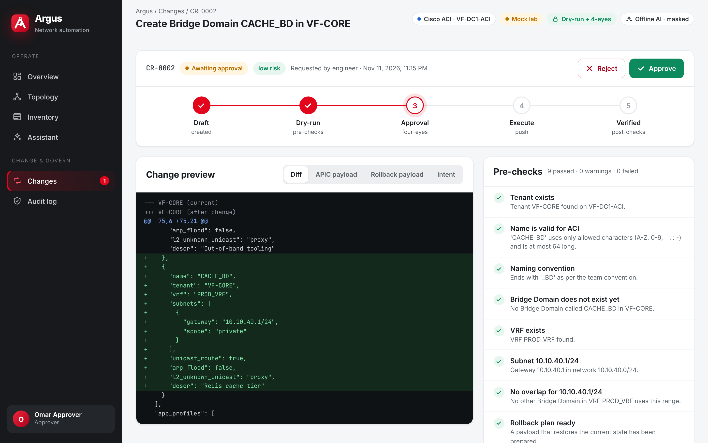
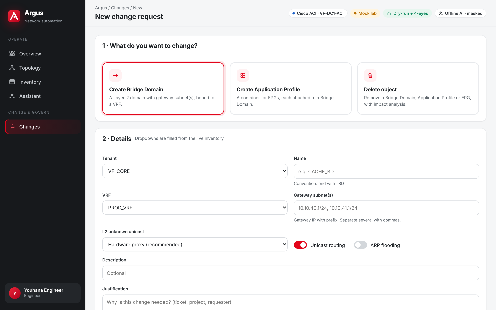
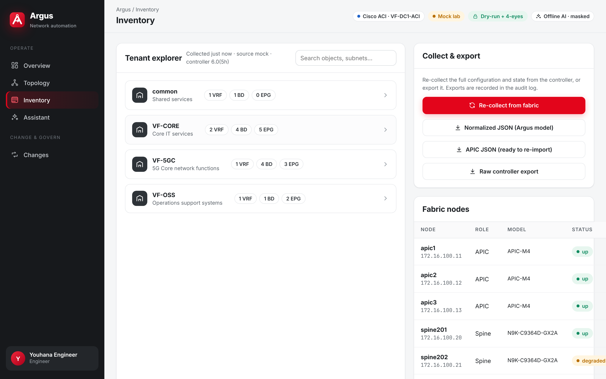
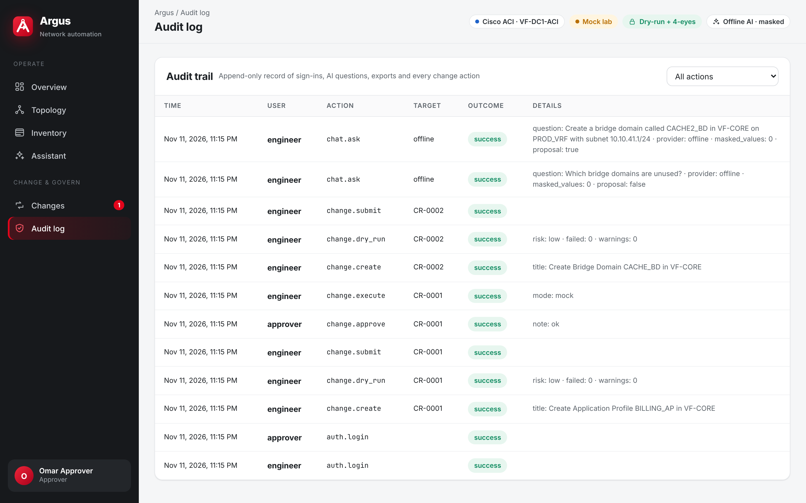
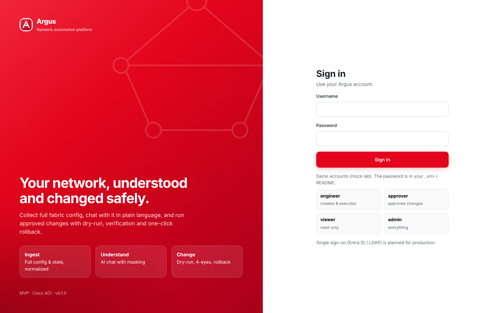
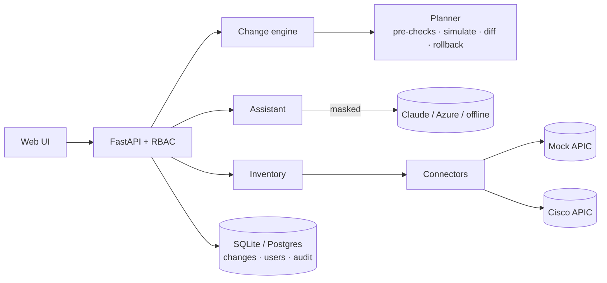

<p align="center">
  
</p>

<p align="center">
  <b>AI-assisted network automation platform for the cloud automation team</b><br>
  Ingest full config &amp; state · chat with your network · run governed changes with dry-run, four-eyes approval and rollback
</p>

<p align="center">
  
  
  
  
  
  
</p>

<p align="center"></p>

---

## Why Argus

Network changes in a large data center fabric are slow and risky because the knowledge is spread over controllers, CLI sessions and people's heads. Argus brings it together:

| Capability | What it does for the engineer |
|---|---|
| **1 · Ingest & export** | Collects the full configuration and state of a target and turns it into **one vendor-neutral model**. You can export it as normalized JSON, as APIC JSON that is ready to re-import, or as the raw controller export. |
| **2 · Understand** | **Chat with the network**: *"Which bridge domains are unused?"*, *"Where is 10.50.3.20?"*, *"Are any links down?"*. Physical and logical **topology graphs** show the same data. |
| **3 · Change** | Change requests (**create Application Profile, create Bridge Domain, delete object**) go through **dry-run → approval by a second user → execute → post-checks**, with a **one-click rollback** that restores the exact previous state. |
| **Always** | Role-based access, an **audit log** of every action, and **masking** of IPs, serials and secrets before anything reaches an AI model. |

The MVP targets **Cisco ACI**. The connector design is ready for NX-OS, FortiGate, Juniper, Palo Alto and VMware.

## Executive presentation: `/present`

Argus has a built-in presentation page about the application at **http://127.0.0.1:8000/present** (or `http://<host>:8000/present` on a server).

- **Who it's for:** managers and senior leadership. It explains the platform in plain, non-technical language.
- **What it covers:** the problem, the three capabilities (Ingest, Ask, Act), how a change flows from request to verified result, how the AI keeps data private, the safety guardrails, the business value and the roadmap.
- **Access:** public. It needs no login and shows no network data, so it's safe to put on a meeting-room screen.
- **How to use it in a demo:** open it first as your opening slide, scroll through it, then click **Open live demo** to go to the sign-in page.
- **Source:** `argus/web/templates/present.html` (route in `argus/main.py`).

## Screenshots

| | |
|---|---|
|  <br>**Physical fabric:** spine-leaf graph, a down link highlighted, node details |  <br>**Logical view:** Tenant → VRF → BD/L3Out → EPG, unused BDs flagged |
|  <br>**Assistant:** answers from live inventory and drafts changes |  <br>**Change request:** lifecycle, diff, pre-checks, four-eyes approval |
|  <br>**New change:** guided form filled from the inventory |  <br>**Inventory:** tenant explorer and export |
|  <br>**Audit log:** every sign-in, question, export and change |  <br>**Sign-in:** local accounts, SSO-ready |

## Quick start

> **Renamed from AutoHero.** The platform is now called **Argus**. The Python package is `argus`, the CLI is `argus`, and settings use the `ARGUS_` prefix (for example `ARGUS_LLM_PROVIDER`). If you have an older `.env`, replace `AUTOHERO_` with `ARGUS_` in it, and run `pip install -e .` again so the `argus` command is installed. The GitHub repository is still named `AutoHero` until it is renamed there.


### Option A: Python (Windows, macOS or Linux)

```bash
git clone https://github.com/youhana-sobhy/AutoHero.git
cd AutoHero
python -m venv .venv
# Windows: .venv\Scripts\activate    macOS/Linux: source .venv/bin/activate
pip install -e ".[dev]"
cp .env.example .env          # optional: adjust settings
argus serve                # http://127.0.0.1:8000  (executive overview: /present)
```

### Option B: Docker Compose (on-prem)

```bash
cp .env.example .env
docker compose up -d --build  # http://<host>:8000
```

Add PostgreSQL with `docker compose --profile postgres up -d` and set `ARGUS_DATABASE_URL=postgresql+psycopg://argus:<pw>@db:5432/argus` in `.env`. For this, the image also needs `pip install ".[postgres]"`.

### Demo accounts

All of them use the password in `ARGUS_DEMO_PASSWORD`. The default in `.env.example` is `Argus-Demo-2026`. **Change it before you share the instance.**

| User | Role | Can |
|---|---|---|
| `engineer` | engineer | Create, dry-run, submit and execute changes, export config |
| `approver` | approver | Approve or reject changes, roll back, read the audit log |
| `viewer` | viewer | Read-only: inventory, topology, assistant |
| `admin` | admin | Everything, plus resetting the mock lab (still can't approve their own change) |

## Five-minute demo script (for management)

> **Executive overview page:** open **http://127.0.0.1:8000/present** first. It is a one-page, non-technical summary of what Argus does, made for managers. It needs no login and shows no fabric data. Use it as the opening slide, then click **Open live demo**.

1. **Sign in as `engineer`.** The overview shows fabric health, open changes and a down link that needs attention.
2. **Topology:** click `bleaf106` to see the down uplink to `spine202`. Switch to **Logical**, pick `VF-5GC` and notice that `LEGACY_BD` is flagged as unused.
3. **Assistant:** ask *"Which bridge domains are unused?"*, then *"Create a bridge domain called CACHE_BD in VF-CORE on PROD_VRF with subnet 10.10.40.1/24"*, and click **Create draft & run dry-run**.
4. **Change request:** walk through the **9 pre-checks**, the **diff**, the **APIC payload** and the **rollback payload**. Then **Submit for approval**.
5. **Sign out and sign in as `approver`.** Open the change and **Approve** it. (Approving your own change is blocked by the four-eyes rule.)
6. **Sign in as `engineer` again** and click **Execute**. Argus re-checks for drift, pushes the change and verifies it with post-checks. Then show **Roll back**.
7. **Safety net:** try *Delete AMF_BD*. The dry-run is **blocked** because EPGs still use it.
8. **Audit log** (as approver): every step is recorded.

As admin, *Inventory → Reset mock lab* restores the seed fabric for the next demo.

## Agreed MVP decisions

These were agreed before the build and are detailed in [docs/ARCHITECTURE.md §2](docs/ARCHITECTURE.md#2-agreed-decisions-mvp).

| Topic | Decision |
|---|---|
| First vendor | **Cisco ACI**. Other vendors are on the roadmap behind the same connector interface |
| Demo change types | **Create Application Profile**, **create Bridge Domain**, **delete object** (BD / AP / EPG) |
| Lab | **Mock ACI fabric** in native APIC JSON. The **real APIC REST connector** is ready (`ARGUS_CONNECTOR=apic`) |
| Data format | **Normalized JSON** model, plus APIC JSON and raw exports |
| AI provider | **Anthropic Claude first**. **Azure OpenAI** is one setting away (planned once the Azure key is issued). **Offline** mode is the demo default |
| AI data protection | **Masking** of IPs, serials and secrets before any LLM call (`ARGUS_REDACT=true`) |
| UI | **FastAPI web app** with a polished, branded UX. Topology graph included |
| Change flow | **Draft → dry-run → approval by a second user → execute → post-checks → rollback** |
| ITSM | **None in the MVP**. A hook point is ready for ServiceNow |
| Auth / RBAC | **Local users**, with the roles viewer / engineer / approver / admin. **SSO-ready** |
| Deployment | **Docker Compose on-prem**, plus a `pip install` path |
| Stack | **Python 3.11+**. **SQLite** for the demo, **Postgres-ready** |
| Audit | **Yes**. Append-only audit log |
| Branding | **Original** red/white identity. **No official logos** ([brand book](docs/BRAND_BOOK.md)) |
| Demo focus | **Depth of one polished flow** |
| Git | Feature branch, no PR unless requested |

## Configuration

All settings are environment variables (or `.env`). See [`.env.example`](.env.example).

| Variable | Default | Meaning |
|---|---|---|
| `ARGUS_CONNECTOR` | `mock` | `mock` (built-in ACI lab) or `apic` (real controller) |
| `ARGUS_APIC_URL` / `_USERNAME` / `_PASSWORD` | – | APIC credentials (use a dedicated, least-privilege account) |
| `ARGUS_APIC_VERIFY_TLS` | `true` | Verify the APIC certificate |
| `ARGUS_ALLOW_LIVE_EXECUTION` | `false` | **Safety switch.** Changes on a real APIC are refused unless this is `true` |
| `ARGUS_LLM_PROVIDER` | `mock` | `mock` (offline), `anthropic` (Claude) or `azure` (Azure OpenAI) |
| `ANTHROPIC_API_KEY` / `ARGUS_ANTHROPIC_MODEL` | – / `claude-opus-5-5` | Claude settings |
| `AZURE_OPENAI_ENDPOINT` / `_API_KEY` / `_DEPLOYMENT` / `_API_VERSION` | – | Azure OpenAI settings |
| `ARGUS_REDACT` | `true` | Mask sensitive values before LLM calls |
| `ARGUS_DATABASE_URL` | SQLite in `runtime/` | SQLAlchemy URL (Postgres supported) |
| `ARGUS_SECRET_KEY` | dev key | Session signing key. **Set this in any shared environment** |
| `ARGUS_DEMO_PASSWORD` | `Argus-Demo-2026` | Password used to seed the demo users |

### Switching AI provider

```env
# Claude (Anthropic)
ARGUS_LLM_PROVIDER=anthropic
ANTHROPIC_API_KEY=sk-ant-...

# Azure OpenAI
ARGUS_LLM_PROVIDER=azure
AZURE_OPENAI_ENDPOINT=https://<resource>.openai.azure.com
AZURE_OPENAI_API_KEY=...
AZURE_OPENAI_DEPLOYMENT=<deployment-name>
```

If the provider can't be reached, the assistant falls back to offline mode and tells the user.

## Architecture at a glance



The full design (components, data model, lifecycle, security, deployment, extension guide and roadmap) is in **[docs/ARCHITECTURE.md](docs/ARCHITECTURE.md)**.

## Project layout

```
argus/
  main.py              FastAPI app + page routes (incl. public /present overview)
  config.py            settings from env / .env
  db.py                SQLAlchemy models (users, changes, events, audit)
  cli.py               `argus serve | export | reset-lab`
  api/routes.py        JSON API (auth, inventory, topology, chat, changes, audit)
  core/                model.py (normalized model), inventory, security (RBAC), audit
  connectors/          base interface, aci_mo (normalize/export), aci_mock, aci_apic, registry
  changes/             intents, planner (dry-run + post-checks), engine (lifecycle)
  ai/                  providers (Anthropic, Azure OpenAI), redaction, assistant
  web/                 templates + static (CSS design system, JS app, logo)
  data/mock/           seed fabric in native APIC JSON
docs/                  ARCHITECTURE.md, BRAND_BOOK.md, brand assets, screenshots
tests/                 planner, API lifecycle, RBAC, AI/redaction tests
```

## API

Interactive OpenAPI docs are at `/docs` once the app is running. The executive presentation is at `/present` (no login). The key endpoints:

| Method | Path | Purpose |
|---|---|---|
| `POST` | `/api/auth/login` · `/api/auth/logout` | Session sign-in / out |
| `GET` | `/api/inventory/snapshot` | Normalized model + stats |
| `POST` | `/api/inventory/sync` | Re-collect from the target |
| `GET` | `/api/inventory/export?format=normalized\|apic\|native` | Download the config |
| `GET` | `/api/topology` | Physical + logical graph data |
| `POST` | `/api/chat` | Ask the assistant |
| `GET/POST` | `/api/changes` | List / create (create runs the dry-run) |
| `POST` | `/api/changes/{id}/{dry-run\|submit\|approve\|reject\|execute\|rollback}` | Lifecycle actions |
| `GET` | `/api/audit` | Audit trail |

CLI: `argus export --format apic > fabric.json` and `argus reset-lab`.

## Testing

```bash
pytest -q
```

There are 20 tests. They cover the normalizer, export round-trip, every pre-check family, mock APIC semantics, execute/rollback (including restoring a deleted AP with its EPGs), RBAC, the four-eyes rule, the API lifecycle, exports and the guarantee that an external LLM only ever receives masked data.

## Security notes

- Run Argus behind a TLS reverse proxy, and set a strong `ARGUS_SECRET_KEY` and demo password.
- Keep `ARGUS_ALLOW_LIVE_EXECUTION=false` until the APIC integration has been validated in a lab.
- Give the APIC account only the privileges Argus needs (tenant-scoped write).
- Review the data-handling policy before you enable an external LLM. Masking is on by default, and offline mode sends nothing.

## Roadmap

**Phase 2:** real APIC lab, Entra ID SSO, Postgres, ServiceNow change records, change windows.
**Phase 3:** NX-OS, FortiGate and Palo Alto connectors, more intents (VRF, BGP peer, contracts, static ports).
**Phase 4:** Juniper and VMware, closed-loop assurance (detect drift, then propose or auto-fix low-risk issues under policy).

---

<sub>Argus uses an original visual identity. It is not affiliated with or endorsed by any operator brand, and it contains no third-party logos. Mock lab data is fictional.</sub>
