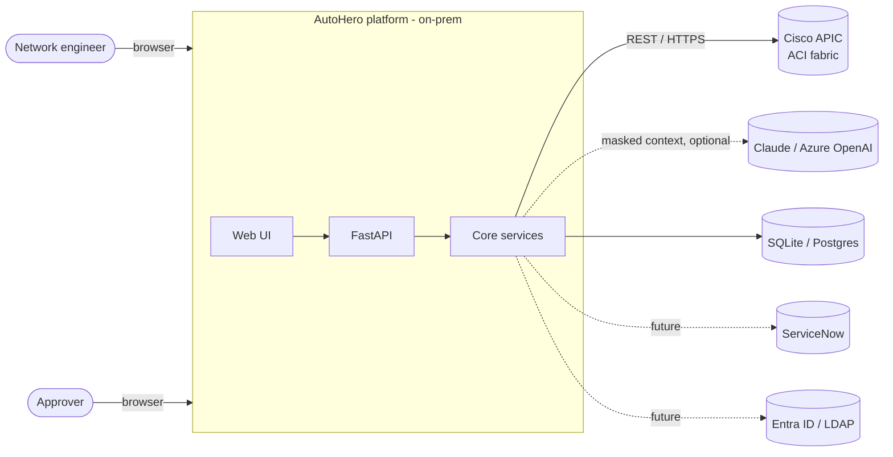
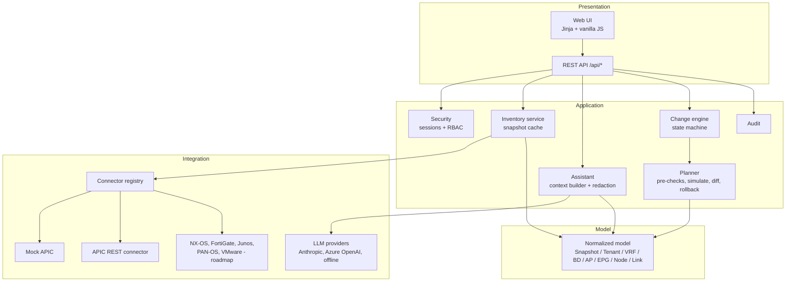
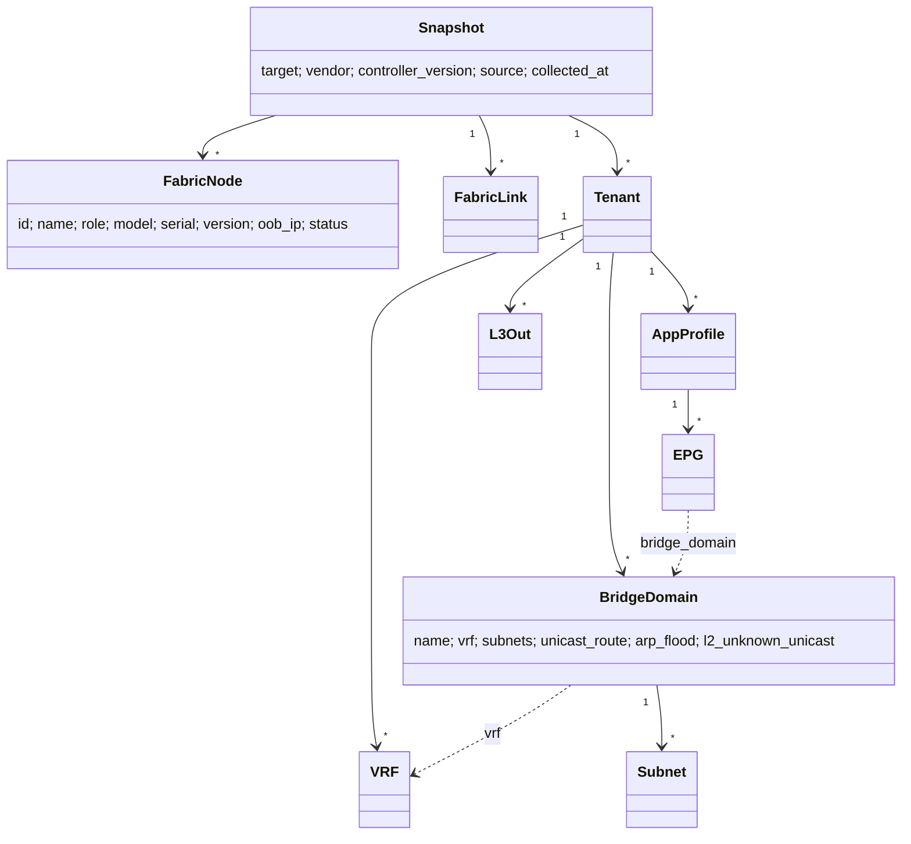
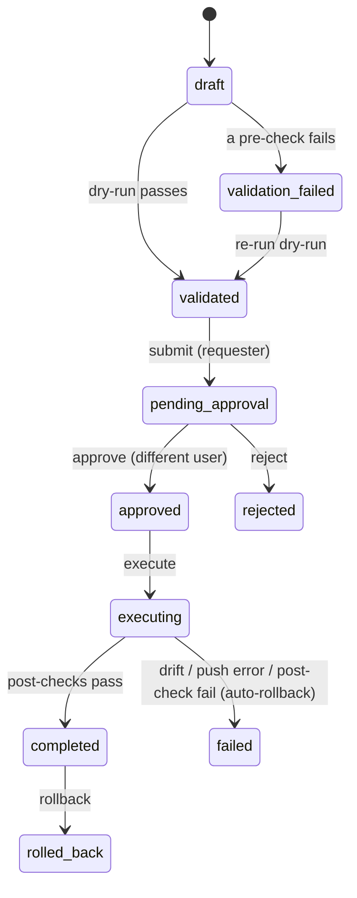
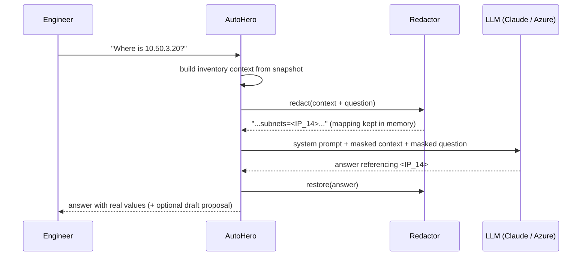
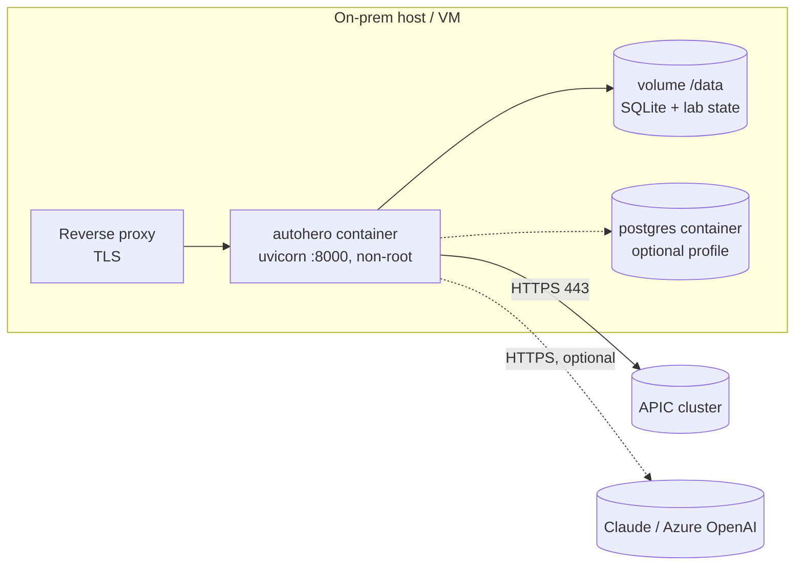

# AutoHero architecture

| | |
|---|---|
| **Document** | Solution architecture, MVP (v0.1.0) |
| **Scope** | Cisco ACI. Ingest, conversational insight, governed change execution |
| **Status** | MVP for management review. Runs on a mock lab with dry-run as the default |
| **Audience** | Cloud automation team, architecture board, security and operations |

---

## 1. Purpose

AutoHero is the automation platform for the cloud automation team's work on L2 to L4 autonomous networks. It brings three capabilities into one tool:

1. **Ingest and export.** It collects the full configuration and state of a target and turns it into one vendor-neutral model. You can export that model, or the native vendor format.
2. **Understand.** Engineers can chat with the platform about topology and configuration in plain language.
3. **Change.** It runs change requests (create, modify, delete) through a governed lifecycle: dry-run, four-eyes approval, execution, verification and rollback.

The MVP proves all three end to end on **Cisco ACI**. The design is plugin-based, so NX-OS, FortiGate, Juniper, Palo Alto and VMware can be added without changing the core.

## 2. Agreed decisions (MVP)

These decisions were agreed with the product owner before the build. Each one is reflected in the code.

| # | Topic | Decision | Where in the code |
|---|---|---|---|
| D1 | First vendor | **Cisco ACI** only. Other vendors come later behind the same connector interface | `autohero/connectors/` |
| D2 | Demo changes | **Create Application Profile**, **create Bridge Domain**, **delete object** (BD, AP or EPG) | `autohero/changes/intents.py` |
| D3 | Lab access | **Mock ACI fabric** (native APIC JSON). A **real APIC REST connector** is ready to switch on | `connectors/aci_mock.py`, `connectors/aci_apic.py` |
| D4 | Data format | **Normalized JSON** model. Export as normalized JSON, APIC JSON or the raw controller export | `core/model.py`, `/api/inventory/export` |
| D5 | LLM provider | **Anthropic Claude first**, with **Azure OpenAI** one setting away. An **offline engine** is the demo default and needs no key | `ai/providers.py` |
| D6 | Data protection | **Mask IPs, serials and secrets** before any LLM call, and restore them in the answer | `ai/redaction.py` |
| D7 | UI | **FastAPI web app** with a polished, branded UX (no build step) | `autohero/web/` |
| D8 | Topology view | **Yes**: physical spine-leaf graph plus a logical tenant graph | `web/static/js/app.js` |
| D9 | Change flow | **Draft → dry-run → approval by a second user → execute → post-checks → rollback** | `changes/engine.py` |
| D10 | ITSM | **No integration in the MVP**. There is a clean hook point for ServiceNow later | `changes/engine.py` |
| D11 | Auth / RBAC | **Local users**, with the roles **viewer, engineer, approver, admin**. **SSO-ready** | `core/security.py` |
| D12 | Deployment | **Docker Compose on-prem**, plus a plain `pip install` path | `Dockerfile`, `docker-compose.yml` |
| D13 | Stack | **Python 3.11+**. **SQLite** for the demo, **Postgres-ready** | `db.py` |
| D14 | Audit | **Yes**. An append-only audit log of sign-ins, AI questions, exports and change actions | `core/audit.py` |
| D15 | Branding | **Original** red and white identity inspired by telco conventions. **No official logos** | `docs/BRAND_BOOK.md` |
| D16 | Demo focus | **Depth of one polished flow** rather than breadth of vendors | - |
| D17 | Git | Work on a **feature branch**, pushed, with no PR unless requested | - |

## 3. Context



## 4. Logical architecture



### 4.1 Components

| Component | Responsibility |
|---|---|
| **Connector** (`connectors/base.py`) | One class per vendor. `fetch_native()` returns the raw export, `fetch_snapshot()` returns the normalized model, and `apply(payload)` pushes a native change. The rest of the platform never handles vendor payloads directly. |
| **ACI MO helpers** (`connectors/aci_mo.py`) | APIC managed-object tree handling: RN rules, merging `status=created/deleted` payloads, the **normalizer** (APIC JSON to model) and the **exporter** (model to APIC JSON). |
| **Mock APIC** (`connectors/aci_mock.py`) | An in-memory ACI fabric seeded from native APIC JSON. It follows APIC semantics: `created` fails if the object already exists, and `deleted` removes the subtree. State persists across restarts until the lab is reset. |
| **APIC connector** (`connectors/aci_apic.py`) | The real controller: `aaaLogin`, class queries with `rsp-subtree=full`, and `POST /api/mo/uni.json`. Execution is blocked unless `AUTOHERO_ALLOW_LIVE_EXECUTION=true`. |
| **Inventory** (`core/inventory.py`) | Caches the latest snapshot (5 min TTL) and invalidates it after every change. |
| **Planner** (`changes/planner.py`) | Turns an intent into a payload, a rollback payload, pre-checks, a simulated result, a diff and a risk rating. It also runs post-checks. |
| **Change engine** (`changes/engine.py`) | Runs the lifecycle state machine, the four-eyes rule, the drift check, execution, verification and automatic rollback. |
| **Assistant** (`ai/assistant.py`) | Builds a compact inventory context, masks it, calls the provider, restores real values and extracts a draft-change proposal. |
| **Security** (`core/security.py`) | PBKDF2 password hashing, signed session cookie and a permission matrix. |
| **Audit** (`core/audit.py`) | Append-only event log. |

## 5. Normalized data model



**Mapping (ACI to the model):** `fvTenant`→Tenant, `fvCtx`→VRF, `fvBD`+`fvRsCtx`+`fvSubnet`→BridgeDomain, `fvAp`→AppProfile, `fvAEPg`+`fvRsBd`→EPG, `l3extOut`→L3Out, `fabricNode`+`topSystem`→FabricNode, `fabricLink`→FabricLink.

The model is vendor-neutral by design. For example, an NX-OS VLAN with an SVI maps to a BridgeDomain with a Subnet, and a FortiGate VDOM maps to a Tenant. New vendors add mappings, not new UI.

## 6. Change lifecycle



### 6.1 Dry-run (planner)

All of the following happens **without touching the target**:

1. **Pre-checks**, each with a plain-language explanation:
   - the tenant exists and is not a protected system tenant (`common`, `infra`, `mgmt` for deletes)
   - the name is valid for ACI (`[A-Za-z0-9_.:-]{1,64}`) and follows the team convention (`_BD`, `_AP`, `_EPG`, given as a warning)
   - for creates, the object does not exist yet; for deletes, it does exist
   - **for a BD**: the VRF exists, the gateway is a host address (not the network or broadcast address), and the subnet **does not overlap** with any other BD in the same VRF
   - **for an AP**: the BD of each EPG exists and the EPG names are unique
   - **for a delete**: a BD still used by EPGs is a blocker, and an AP that has EPGs gets a warning listing them
   - a rollback payload can be built
2. **Simulation.** The payload is applied to a **sandbox copy** of the live configuration and re-normalized.
3. **Diff.** A unified diff of the tenant before and after.
4. **Risk.** Low for a clean create, medium for a create with warnings or a small delete, high for a large blast radius or any failed check.

### 6.2 Execution safeguards

| Safeguard | Behaviour |
|---|---|
| Four-eyes | The approver must be a different person from the requester. Admins are no exception. |
| Drift check | Just before pushing, the platform re-plans against the **current** state. If a pre-check no longer passes, it aborts. |
| Post-checks | The result is verified on a **fresh snapshot**: the object is present or absent as expected, and the VRF binding, subnets and EPGs match. |
| Auto-rollback | If post-checks fail, the rollback payload is applied straight away. |
| Manual rollback | A completed change can be rolled back. A delete is rolled back by re-creating the **exact original subtree**. |
| Live guard | The real APIC connector refuses `apply()` unless `AUTOHERO_ALLOW_LIVE_EXECUTION=true`. |
| Mock by default | `AUTOHERO_CONNECTOR=mock` is the default, so a demo can never reach production. |

## 7. AI assistant



- **Providers** (`AUTOHERO_LLM_PROVIDER`):
  - `anthropic` uses Claude through the Anthropic SDK. The default model is `claude-opus-5-5`, with low effort for chat and the server-side refusal fallback enabled.
  - `azure` uses Azure OpenAI with your deployment name.
  - `mock` is the offline, deterministic engine (the demo default).
  - If a provider fails, the assistant falls back to offline mode and says so.
- **Redaction** masks IPv4/IPv6 addresses with their prefix, device serials and `password=`/`token=`/`community=` style secrets. Tokens are consistent within a request, so the model can still reason about relationships.
- **No autonomy over changes.** The model can only emit an `autohero-change` JSON block. AutoHero validates it against the intent schema and shows it as a *draft*, and the draft follows the full lifecycle.
- **Audit.** Each question (truncated), the provider used and the number of masked values are logged.

**Switching to Azure OpenAI** needs configuration only:

```env
AUTOHERO_LLM_PROVIDER=azure
AZURE_OPENAI_ENDPOINT=https://<resource>.openai.azure.com
AZURE_OPENAI_API_KEY=<key>
AZURE_OPENAI_DEPLOYMENT=<deployment-name>
```

## 8. Security

| Area | MVP | Production path |
|---|---|---|
| Authentication | Local users, PBKDF2-SHA256 (240k iterations), signed `SameSite=Strict` session cookie, 8 h expiry | OIDC with Entra ID or LDAP. Identity is resolved in one place (`current_user`) |
| Authorization | Permission matrix for the roles viewer, engineer, approver and admin, enforced on every API route | Map roles from IdP groups |
| Separation of duties | Four-eyes approval | Change windows, CAB integration |
| Secrets | `.env` / environment variables, never logged | Vault / Kubernetes secrets |
| Data to AI | Masking on, offline by default | DLP review, Azure tenant-bound endpoint |
| Transport | Run behind TLS reverse proxy | mTLS to controllers, verified certificates (`AUTOHERO_APIC_VERIFY_TLS=true`) |
| Audit | Append-only table | Ship to SIEM (Splunk / Sentinel) |

**Role permissions**

| Permission | viewer | engineer | approver | admin |
|---|:-:|:-:|:-:|:-:|
| View inventory, topology, changes; use assistant | ✓ | ✓ | ✓ | ✓ |
| Export / re-collect config | | ✓ | ✓ | ✓ |
| Create change, dry-run, submit, execute | | ✓ | | ✓ |
| Approve / reject | | | ✓ | ✓ (not own) |
| Roll back | | ✓ | ✓ | ✓ |
| Audit log | | | ✓ | ✓ |
| Reset mock lab | | | | ✓ |

## 9. Deployment



- `docker compose up -d` starts the demo.
- `docker compose --profile postgres up -d` adds PostgreSQL. Point `AUTOHERO_DATABASE_URL` to it.
- The image runs as a non-root user, has a health check (`/api/health`) and stores all state in `/data`.
- Scaling: the app is stateless apart from the database and the connector state, so with Postgres you can run several replicas behind the proxy.

## 10. Extending AutoHero

**Add a vendor:**
1. Implement `Connector` (`fetch_native`, `fetch_snapshot`, `apply`).
2. Map native objects to the normalized model.
3. Register a factory in `connectors/registry.py`.
4. Add vendor-specific planner rules where they are needed.

**Add a change type:**
1. Add an intent model in `changes/intents.py`.
2. Add `_plan_<kind>` (payload, rollback, checks) and `verify()` rules in `planner.py`.
3. Add a card and a form section in `change_new.html`.

**Add an ITSM hook:** in `engine.submit` and `engine.execute`, create or update the ticket and store its ID in `ChangeRequest.result`.

## 11. Roadmap

| Phase | Scope |
|---|---|
| **MVP (now)** | Cisco ACI, three change types, mock lab, Claude/Azure/offline AI, RBAC, audit, Docker |
| **Phase 2** | Real APIC lab integration, SSO (Entra ID), Postgres, ServiceNow change records, change windows |
| **Phase 3** | NX-OS / Nexus, FortiGate, Palo Alto connectors. More intents (VRF, BGP peer, contracts, static ports) |
| **Phase 4** | Juniper, VMware NSX/vSphere. Closed-loop assurance (L4 autonomy): detect drift, propose and auto-remediate low-risk fixes with policy guardrails |

## 12. Known MVP limitations

- Only one target (fabric) per instance.
- Mock lab only. The APIC connector is implemented but has not yet been run against a real controller.
- The offline assistant understands common question patterns. For free-form questions, use Claude or Azure.
- CSRF protection relies on a `SameSite=Strict` cookie and JSON-only APIs. Add CSRF tokens before exposing it beyond a trusted network.
- No multi-tenant isolation of AutoHero users per ACI tenant yet.
