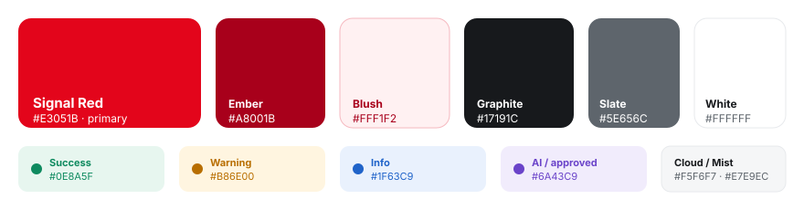

# Argus brand book

**Version 1.0 · MVP**

Argus has its own original identity, designed to sit comfortably inside a large telco's internal tooling landscape. It uses a confident red with plenty of white, graphite and air.

> **Trademark note.** Argus does **not** use any official operator logo, the "speech mark" symbol, proprietary typefaces or trademarked assets. The red is an original value (`#E3051B`, "Signal Red") chosen to feel at home next to telco reds without copying one. If Argus is ever co-branded, the corporate brand team must supply the official assets and guidelines, and those take precedence over this document.

---

## 1. Brand idea

**"Your network, understood and changed safely."**

Argus is the calm expert at the engineer's side. It reads the whole fabric, explains it in plain language, and never makes a change without a dry-run, a second pair of eyes and a way back.

| Attribute | Means | Does not mean |
|---|---|---|
| **Trustworthy** | Shows its work: checks, diffs, audit trail | Hides complexity behind "magic" |
| **Clear** | Short sentences, exact object names | Jargon walls, vague "something went wrong" |
| **Confident** | Bold red accents, decisive actions | Shouting, red everywhere |
| **Human** | Greets people by name, plain language | Cutesy, emoji-heavy |

## 2. Logo

 &nbsp;&nbsp; 

**The name.** Argus is the hundred-eyed watchman of Greek myth who never sleeps and sees everything. It stands for what the platform does: it knows the live state of the network, checks before a change and verifies after it. It also pairs naturally with the team's Hydra automation front end: *Hydra executes, Argus sees.*

**The mark** is an "A" drawn as a network path that climbs to a summit node, the watchful eye where the platform sees everything. A forward arrow crosses the A, standing for change moving forward. It sits in a rounded square (radius 25% of the size) with a Signal Red to Ember gradient.

**The wordmark** is "Argus" in Graphite, set in Inter ExtraBold (800) with -2% tracking. The optional descriptor "NETWORK AUTOMATION" is Inter SemiBold, all caps, with +20% tracking, in Slate.

| Rule | Value |
|---|---|
| Clear space | At least the height of the summit node (≈ 1/8 of the mark) on every side |
| Minimum size | Mark 20 px / 6 mm. Horizontal logo 120 px / 32 mm wide |
| On dark backgrounds | Mark as is. Wordmark "Argus" in white |
| On red backgrounds | White mark tile with a red symbol, white wordmark |

**Don't:** recolor the mark, add shadows or outlines, rotate it, stretch it, put it inside a circle or speech bubble, or combine it with any operator logo without brand approval.

Files: [`brand/argus-mark.svg`](brand/argus-mark.svg), [`brand/argus-logo-horizontal.svg`](brand/argus-logo-horizontal.svg)

## 3. Color

| Token | Hex | Use |
|---|---|---|
| `--red` Signal Red | `#E3051B` | Primary actions, active navigation, key highlights, the brand |
| `--red-700` Ember | `#A8001B` | Hover/pressed, text on Blush, gradients |
| `--red-50` Blush | `#FFF1F2` | Soft highlight backgrounds, proposal cards |
| `--graphite` | `#17191C` | Sidebar, dark surfaces, headings |
| `--ink` | `#1B1F23` | Body text |
| `--slate` | `#5E656C` | Secondary text, captions |
| `--mist` | `#E7E9EC` | Borders and dividers |
| `--cloud` | `#F5F6F7` | Page background |
| `--white` | `#FFFFFF` | Cards, primary canvas |
| `--green` | `#0E8A5F` | Success, "pass", link up |
| `--amber` | `#B86E00` | Warnings, awaiting approval, mock lab |
| `--blue` | `#1F63C9` | Information, APIC controllers, dry-run passed |
| `--violet` | `#6A43C9` | AI provider, approved state, EPGs |

**Proportion: 60 · 30 · 10.** About 60% white and Cloud, 30% Graphite and neutrals, and 10% Signal Red. Red marks what matters. When everything is red, nothing stands out.

**Meaning beats decoration.** Status colors are reserved for status. Red also means "failed" or "down", so never use red for a neutral label.

**Accessibility.** Signal Red on white is 4.9:1, which passes WCAG AA for normal text. White on Signal Red is the same. Ember on Blush is 7.1:1. Slate on white is 5.9:1.

## 4. Typography

| Role | Typeface | Weight / size |
|---|---|---|
| Display / H1 | **Inter** | 800 · 24–40 px · tracking -2% |
| Headings | Inter | 700 · 15–18 px |
| Body | Inter | 400–500 · 14 px · line-height 1.5 |
| Labels / overlines | Inter | 600–700 · 11–12 px · all caps · +8–12% tracking |
| Code, payloads, IDs | **JetBrains Mono** | 400–600 · 12–12.5 px |

Both typefaces are open source (SIL Open Font License). The fallback stack is `Segoe UI, system-ui, Arial`, so the UI still works offline.

## 5. Shape, depth and spacing

- **Radius.** Cards 14 px, buttons and inputs 10 px, pills fully rounded, hero banners 18 px.
- **Elevation.** Mostly flat, with a 1 px border in Mist. Use a soft shadow only on hover, menus and modals. Primary buttons and hero banners get a red glow (`0 10px 30px rgba(227,5,27,.28)`).
- **Spacing.** The base unit is 4 px, with steps of 8 / 12 / 16 / 20 / 24 / 28. Page gutters are 28 px and card padding is 18–20 px.
- **Grid.** Fixed sidebar (248 px) with a fluid content area (max 1480 px). The main layout is 1.6 : 1.

## 6. Iconography

The icons are an original set: 24 px grid, 1.9 px rounded stroke, no fills, drawn with `currentColor`. Network objects have consistent icons: tenant (building), BD (bridge), EPG (target), application profile (four tiles), node (chassis). Icons support labels and never replace them.

## 7. UI components

| Component | Rule |
|---|---|
| **Primary button** | Signal Red, white text. **One per view** is the main action (for example "Execute", "Submit for approval") |
| **Secondary button** | White with a Mist border |
| **Destructive** | White with Ember text and a pink border, and always a confirmation dialog |
| **Status pill** | Tinted background with a darker text color and a leading dot. Use the labels in §9 |
| **Environment badges** | Always visible top-right: target, **Mock lab** (amber) or **LIVE FABRIC** (solid red, pulsing), "Dry-run + 4-eyes", AI provider |
| **Lifecycle stepper** | Five steps: Draft, Dry-run, Approval, Execute, Verified. Red when done, ring for the current step, graphite with a cross when failed |
| **Diff** | Dark code surface. Additions in green, removals in red, hunks in blue |

## 8. Data visualisation and topology

- **Spines** have a red accent strip, **leaves** graphite, **border leaves** slate and **APICs** blue.
- **Links.** An up link is a 1.6 px grey line. A down link is a 2.5 px Signal Red dashed line.
- **Node status dot.** Green when up, amber when degraded, red when down.
- **Logical view**, from left to right: Tenant (graphite), VRF (red), BD or L3Out (graphite or green), EPG (violet). An unused BD gets an amber dashed outline.

## 9. Voice and wording

- Write for a busy network engineer. Lead with the answer, and name the exact object.
- Use plain verbs such as "Create", "Approve", "Roll back". Avoid "Leverage" and "Utilise".
- An error says **what** happened and **what to do next**. For example, "Still used by EPG 5GC_CORE_AP/AMF_EPG. Move or delete it first."
- Status labels: *Draft · Dry-run passed · Dry-run blocked · Awaiting approval · Approved · Executing · Completed · Failed · Rolled back · Rejected*.
- Use sentence case for UI text. Use all caps only for small overlines.

## 10. Applying the brand

| Surface | Guidance |
|---|---|
| Web app | Implemented in `argus/web/static/css/argus.css`. The CSS custom properties are the source of truth for these tokens |
| Slides | White background, a Graphite title, one red accent per slide, the mark top-left, and screenshots in 14 px rounded frames |
| Docs | The horizontal logo at the top, tables for decisions, and Mermaid diagrams |
| Email / Teams | Use the mark only (no wordmark) as the avatar or icon |
